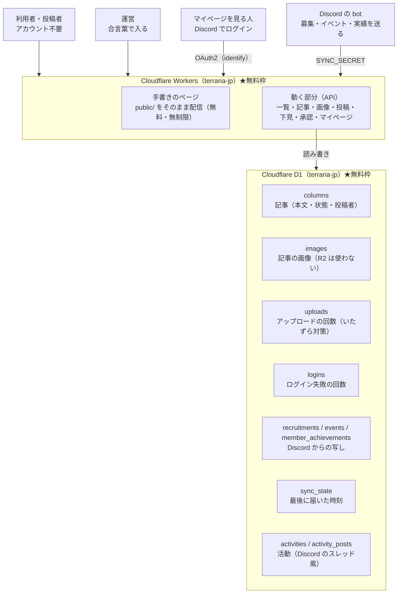

# Cloudflare の使い方 — 公開のしくみと作業手順

このサイトは Cloudflare Workers で動いています。記事も画像も Cloudflare D1 に入るため、
**記事が増えてもデプロイは起きません**。デプロイが要るのは、ページ・CSS・JS・Worker の
コードを直したときだけです。

環境構築（Git / Node.js / エディタ）は [CONTRIBUTING.md](./CONTRIBUTING.md)、
書き方の約束は [CODING_RULES.md](./CODING_RULES.md) を参照してください。

## 1. 全体像



色分けした図解（ブラウザで開く用）は [`dev/architecture.html`](./dev/architecture.html) にあります。
公開サイトには出ません。ファイルをブラウザで直接開いてください（`dev/parts.html` と同じく、
CSS と共通パーツは相対パスで読み込むので、そのまま動きます）。

| 場所                         | URL                                                 |
| ---------------------------- | --------------------------------------------------- |
| サイト                       | https://terraria-jp.terraria-jp-website.workers.dev |
| コラムの投稿                 | `/post`                                             |
| コラムの一覧                 | `/columns`                                          |
| コラムの承認（運営用）       | `/admin/columns`                                    |
| マルチ募集の一覧             | `/recruit`                                          |
| お知らせ                     | `/news`                                             |
| 活動（Discord のスレッド風） | `/activities`（書くには Discord でログイン）        |
| 活動の承認（運営用）         | `/admin/activities`                                 |
| マイページ（実績）           | `/mypage`（Discord でログインした人だけ）           |

記事は「承認待ち」で保存され、運営が承認したものだけが一覧に並びます。
投稿にアカウントは要りません（誰でも投稿できます）。

## 2. 料金が発生しないしくみ

**使うのは Workers と D1 だけ**です。どちらも無料枠を超えると「エラーになる」だけで、
請求は発生しません。使った分だけ請求が来る R2 は使わず、画像も D1 に入れています。

詳しい表と、アプリ側の上限、R2 に移す条件は [README.md](./README.md) の
「料金（無料枠だけで動かす）」にまとめてあります。

守ること:

- **アカウントは Workers Free のまま**にする（支払い方法を登録しない・有料プランに変えない）
- R2・KV・Queues などを足したくなったら、先に運営で相談する
- デプロイ前に `npm run check:free` を通す（有料の設定が混ざっていれば失敗します）

## 3. 初回セットアップ（実施済みの記録）

新しい Cloudflare アカウントで一から作るときの手順です。括弧内は現在の状態です。

| #   | すること                         | コマンド・操作                                                                             | 状態                   |
| --- | -------------------------------- | ------------------------------------------------------------------------------------------ | ---------------------- |
| 1   | Cloudflare に入る                | `npx wrangler login`（`spawn EPERM` で失敗するときは `--device --browser false`）          | 済み                   |
| 2   | D1 を作る                        | `npx wrangler d1 create terraria-jp` → 出た `database_id` を `wrangler.jsonc` に貼る       | 済み（terraria-jp）    |
| 3   | 保存場所を作る                   | `npm run db:remote`（`wrangler d1 execute terraria-jp --remote --file=worker/schema.sql`） | 済み                   |
| 4   | 動作確認用の記事を入れる（任意） | `npx wrangler d1 execute terraria-jp --remote --file=worker/seed.sql`                      | 済み（5 件）           |
| 5   | 合言葉を登録する                 | `npx wrangler secret put ADMIN_PASSWORD`                                                   | 済み                   |
| 6   | 公開する                         | `npm run deploy`                                                                           | 済み                   |
| 7   | 募集の同期の合言葉を登録する     | `npx wrangler secret put SYNC_SECRET`                                                      | 未（bot をつなぐとき） |

合言葉を登録する前は、承認ページのログインが 503 で断られます（誰も入れないほうが安全な
ため、わざとそうしています）。登録すると、次のリクエストから使えるようになります。
募集の同期に使う `SYNC_SECRET` も同じ考え方で、登録するまでは bot からの受け取りが 503 で
断られます。

> 合言葉は運営だけが知る長い文字列にしてください。アシスタントや Issue に貼らないこと。

## 4. ふだんの作業

### 記事を書く・公開する（デプロイ不要）

1. 投稿者が `/post` から書いて送る（アカウント不要）
2. 運営が `/admin/columns` で読んで、公開するかどうかを決める
3. 公開した瞬間から一覧に並ぶ（デプロイは起きない）

### コードを直したとき（デプロイが要る）

```bash
npm run check:free          # 有料の設定が混ざっていないか確かめる
npm run check:events        # 「これからのイベント」の選び方が期待どおりか確かめる
npm run check:recruit       # 「いま立っている募集」の選び方が期待どおりか確かめる
npm run check:achievements  # 実績の取り込み方と、自分の実績の引き方が期待どおりか確かめる
npm run check:mypage        # マイページのログイン（証の署名・期限・合言葉）が期待どおりか確かめる
npm run deploy              # Cloudflare Workers へ公開する
```

### 合言葉を変える

```bash
npx wrangler secret put ADMIN_PASSWORD
```

### マルチ募集・イベント・実績を Discord と同期する

Discord の内容の持ち主は Discord 側です。Discord の bot が集めてサイトへ送り、サイトは
その写しを DB に入れます。サイト側は Discord を叩かないので、Discord が重くてもサイトは
止まりません。

```bash
npx wrangler secret put SYNC_SECRET   # bot とサイトに同じ文字列を入れる
```

| 送るもの                 | 送り先                            | サイトでの出かた                       |
| ------------------------ | --------------------------------- | -------------------------------------- |
| いま立っているマルチ募集 | `POST /api/internal/recruitments` | `/recruit`                             |
| これからのイベント       | `POST /api/internal/events`       | お知らせページの「これからのイベント」 |
| 実績（解放した人）       | `POST /api/internal/achievements` | マイページの「自分の実績」             |

- bot が止まっていても、最後に届いた内容がそのまま残ります（`/recruit` に最終更新が出ます）
- 合言葉が違うと 401、まだ登録していなければ 503 で断ります
- 届いた内容で丸ごと入れ替えるので、何度届いても同じ結果になります（途中で切れても、
  中途半端な一覧は残りません）
- 名前・説明・場所・時刻を Discord 側で直すと、次の入れ替えで新しい内容になります
- 募集は `recruitments`、イベントは `events`、実績は `achievements` と
  `member_achievements`、最後に届いた時刻は `sync_state` に入ります

イベントは、出し方が 2 通りあります。条件は `worker/events.js` の 1 か所だけに書いてあり、
`npm run check:events` で手元で確かめられます。

| イベントの形                     | いつまで出るか                             |
| -------------------------------- | ------------------------------------------ |
| 終わりが決まっている             | 終わるまで（長く続くものでも開催中は出る） |
| 終わりを決めずに立てた（ボイス） | 始まってから 12 時間まで                   |

- イベントの終了は同期しません。終わったものを Discord が返さなくなるので、次に届いた
  ときの入れ替えで消えます。bot が止まっていても、上の表のとおりサイト側で自然に消えます

募集は「まだ生きているか」で出し分けます。条件は `worker/recruitments.js` の 1 か所だけで、
`npm run check:recruit` で手元で確かめられます。Discord のスレッドは、最後の書き込みから
一定時間（普通は 1440 分＝24 時間）で流れます。その時刻を bot から受け取って保存し、
ページは今と比べるだけにしています。

| 募集の状態                            | サイトでの出かた                     |
| ------------------------------------- | ------------------------------------ |
| 流れる時刻がこれから                  | 出る（書き込みで延びれば延びたまま） |
| 流れる時刻を過ぎて、猶予（60 分）の中 | 出る（「流れる時刻を過ぎました」）   |
| 流れる時刻を過ぎて、猶予も過ぎた      | 出さない（「N 件は出していません」） |
| 流れる時刻が分からない（古い行）      | 出る（判断できないものは消さない）   |

実績（マイページに出る「自分の実績」）は、サイト側では知る手立てがありません。Discord の
ロールに出るのは「いまつけている称号 1 つ」だけで、解放済みの持ち主は bot 側の保存場所
（Redis）にしか無いためです。そこで bot が集めて送ります。

- 実績の名前は Discord のロール名をそのまま使います（説明やカテゴリは Discord 側にも無い）
- 実績を消すと、次の入れ替えでサイトからも消えます
- 称号は「いまつけているもの」だけを送ります。解放していない称号はサイト側で付けない扱いに
  します（Discord で直接ロールをつけたときの食い違いを、そのまま出さないため）
- 実績の付与は手動でたまにしか起きないので、bot は 30 分に 1 回だけ送ります。5 分ごとに送ると
  D1 の無料枠（1 日の書き込み行数）を無駄に使うためです（bot 側の `ACHIEVEMENT_SYNC_MINUTES`）

### Web からの操作（実績の付与・称号の着脱）を Discord に反映する

逆向きの道も 1 本だけあります。マイページの「称号にする／外す」と、管理画面
（`/admin/achievements`）の「付与／剥奪」は、サイトからは Discord を触りません。やることを
「依頼」として D1（`achievement_requests`）に 1 行置くだけで、bot が拾って Discord に反映し、
結果を書き戻します。サイトが bot のトークンを持たなくて済みます。

| 操作       | 置かれる依頼        | bot が Discord にやること                      |
| ---------- | ------------------- | ---------------------------------------------- |
| 称号にする | `title` / `set`     | 実績ロールを全部外して、選んだものだけを付ける |
| 称号を外す | `title` / `clear`   | 実績ロールを全部外す                           |
| 実績を付与 | `unlock` / `grant`  | 解放の記録（Redis）に足す（ロールは付けない）  |
| 実績を剥奪 | `unlock` / `revoke` | 解放の記録から消し、着けていればロールも外す   |

- 依頼は 30 秒ごとに拾います（bot 側の `REQUEST_POLL_SECONDS`）。画面は「反映中」を出して
  5 秒ごとに読み直すので、終わればそのまま結果に変わります
- 依頼は 10 分で期限切れになります。bot が止まっている間に溜まった「称号を着ける」を、
  あとから当てないためです。過ぎたものは反映せず「取り消しました」と出ます
- 反映できなかったときは、理由を残します（「Bot の権限が足りません」など）。利用者は
  それを見て、やり直せます
- bot が止まっていても依頼は消えません。動き出したときに拾います（10 分以内のもの）
- 済んだ依頼は 7 日で片付けます（実績を送るときに一緒に消します）
- 反映したあと、bot はすぐに実績を送り直します。マイページの表示が次の読み直しで新しくなります
- サイト側を先に更新してください。新しいサイト（依頼を置く）に古い bot を組み合わせると、
  「反映中」のまま止まります。逆（新しい bot に古いサイト）は、依頼が無いので何も起きません
- 合言葉はサイトの `SYNC_SECRET` です（依頼を読むとき・結果を書き戻すときに使います）。
  新しく増やした秘密はありません

### マイページのログイン（Discord のアプリを作る）

マイページは「自分の実績」を見る場所なので、誰が見ているのかを知る必要があります。そのためだけに
Discord のログイン（OAuth2）を使います。取るのはアカウント名とアイコンだけで、メールアドレスなどは
取りません（`identify` という権限だけ）。

1. https://discord.com/developers/applications を開き、「New Application」でアプリを作る
2. 左の「OAuth2」を開き、「Redirects」に次を足す

    ```
    https://terraria-jp.terraria-jp-website.workers.dev/auth/discord/callback
    ```

3. 同じ画面の「CLIENT ID」を控える。「Reset Secret」で「CLIENT SECRET」を作って控える
   （この 2 つは、人に見せてはいけない値です）
4. Cloudflare に登録する

    ```bash
    npx wrangler secret put DISCORD_CLIENT_ID
    npx wrangler secret put DISCORD_CLIENT_SECRET
    ```

5. ローカルで試すときは、`.dev.vars` にも同じ 2 つを書く

- 2 つとも登録すると、`/mypage` に「Discord でログイン」が出ます。片方でも無いときは「ただいま
  準備中です」（503）になり、誰も入れません（設定し忘れたまま開いてしまうのを防ぐためです）
- ログインした人には、このサイトが署名した 30 日間のクッキー（`mypage_user`）を渡します。
  D1 には何も書きません（無料枠の書き込みを使わないためです）
- 証の鍵は `DISCORD_CLIENT_SECRET` です。Discord 側でシークレットを作り直すと、そのときに全員が
  入れ直しになります。合言葉（`ADMIN_PASSWORD`）とは混ざりません
- ログインのしくみ（署名・期限・行き来の合言葉）は `npm run check:mypage` で手元で確かめられます

### 保存場所に、あとから列や表を足す

`worker/schema.sql` は新しい DB を作るときの形です。すでに動いている DB に列や表を足すときは、
`worker/migrations/` の中のファイルを、リモートとローカルの両方に 1 回ずつ流します。

```bash
npx wrangler d1 execute terraria-jp --local  --file=worker/migrations/001_recruit_activity.sql
npx wrangler d1 execute terraria-jp --remote --file=worker/migrations/001_recruit_activity.sql

npx wrangler d1 execute terraria-jp --local  --file=worker/migrations/002_achievements.sql
npx wrangler d1 execute terraria-jp --remote --file=worker/migrations/002_achievements.sql

npx wrangler d1 execute terraria-jp --local  --file=worker/migrations/003_achievement_web.sql
npx wrangler d1 execute terraria-jp --remote --file=worker/migrations/003_achievement_web.sql

npx wrangler d1 execute terraria-jp --local  --file=worker/migrations/004_activities.sql
npx wrangler d1 execute terraria-jp --remote --file=worker/migrations/004_activities.sql
```

増える列には既定値が入るので、すでに入っているデータは消えません。同じファイルをもう一度
流すと「列がもうある」でエラーになります。`002` と `004` は表を足すだけなので 2 回流しても
何も起きませんが、`003` は列を足すので 1 回だけ流してください（2 回目はエラーになります）。

### ローカルで試す

```bash
npm run db:local       # 初回だけ。ローカルに保存場所を作る
npm run db:local:seed  # 任意。動作確認用の記事を入れる
npm run dev            # http://127.0.0.1:8787 で開ける
```

- ローカルの合言葉は `.dev.vars` に書きます（`Copy-Item .dev.vars.example .dev.vars`）。
  `.dev.vars` は Git に入りません。`ADMIN_PASSWORD` と `SYNC_SECRET` の 2 つを書きます。
- `npm run dev` は同時に 1 つだけにしてください。`wrangler d1 execute --local` も同じ
  ファイルを使うため、同時に動かすと `SQLITE_BUSY` で失敗します。

### 保存されている中身を見る

```bash
# 本番（Cloudflare 上）を見る
npx wrangler d1 execute terraria-jp --remote --command "SELECT id, title, status, created_at FROM columns ORDER BY created_at DESC LIMIT 20;"

# ローカルを見る（先に npm run dev を止める）
npx wrangler d1 execute terraria-jp --local --command "SELECT id, title, status FROM columns;"
```

## 5. 承認ページの使い方（運営）

1. `/admin/columns` を開く
2. 合言葉を入れて「入る」（12 時間は入ったままになります）
3. 「承認待ち / 公開中 / 見送り」で表示を切り替える
4. 記事ごとのボタンで決める

| ボタン         | 動き                                   |
| -------------- | -------------------------------------- |
| 公開する       | 一覧に並ぶ                             |
| 見送る         | 公開しない（記録は残る）               |
| 承認待ちに戻す | いったん保留に戻す                     |
| 削除           | 完全に消す（元に戻せません。確認あり） |

5. 終わったら「出る」

合言葉を間違えると、IP ごとに 10 分あたり 5 回までで止まります（その間は 429）。

### 実績の付与・剥奪（`/admin/achievements`）

合言葉はコラムの承認と同じです（まだなら `/admin/columns` で入っておく）。

1. `/admin/achievements` を開く
2. 「相手」に Discord の ID（メンションでも可）か、名前の一部を入れて「開く」
3. 名前で探したときは、出てきた一覧から相手を選ぶ
4. 実績ごとの「付与」「剥奪」を押す
5. 「反映中」が消えると結果が出る（30 秒ほど。ページは自動で読み直す）

| ボタン | 動き                                                         |
| ------ | ------------------------------------------------------------ |
| 付与   | 解放の記録に足す（Discord のロールは付けない）               |
| 剥奪   | 解放の記録から消す。その実績を称号にしていたら、称号も外れる |

- 名前の一覧に出るのは、一度でも実績を持った人だけです。サイトが知っているのは、bot から
  届いた人だけのためです。はじめて付与する人は、ユーザー ID を入れて開きます
- 実績の名前は Discord のロール名です。Discord に実績を足したら、次の同期（30 分）で出てきます
- 称号の付け替えは本人のマイページから行います（管理画面には入れていません。いま何を
  着けているかは表示だけします）
- 反映待ちの間はボタンを押せません（同じ依頼が二重に溜まらないようにするため）

### 活動の承認（`/admin/activities`）

合言葉はコラムの承認と同じです（まだなら `/admin/columns` で入っておく）。

1. `/admin/activities` を開く
2. 「承認待ちの活動」と「承認待ちの書き込み」を見る（タイトルを押すと、本文まで読めます）
3. それぞれ「公開する」か「見送る」を押す
4. 「公開中の活動」からは「取り下げる」で一覧から下げられます（あとで公開し直せます）

| ボタン     | 動き                                         |
| ---------- | -------------------------------------------- |
| 公開する   | 活動ページ（`/activities`）に並ぶ            |
| 見送る     | 公開しない（記録は残る。あとから公開できる） |
| 取り下げる | 公開中のものを、いったん一覧から下げる       |

- 書けるのは Discord でログインした人だけです。書いた人の名前とアイコンが付きます
- 書き足せるのは、その活動を立てた本人だけです。書き足したぶんも承認してから出ます
- 承認前に読めるのは、立てた本人と運営（合言葉で入った人）だけです
- 本文は書き換えられません。直してもらうときは、見送って本人に書き直してもらいます
- 同じ人が立てられるのは 1 時間に 5 本、書き込めるのは 1 時間に 30 件までです（いたずら対策）

## 6. つまずいたとき

| 症状                                                       | 原因と対処                                                                                                             |
| ---------------------------------------------------------- | ---------------------------------------------------------------------------------------------------------------------- |
| 「合言葉が設定されていません。」と出る                     | まだ `npx wrangler secret put ADMIN_PASSWORD` をしていない                                                             |
| 合言葉が通らない                                           | 10 分間に 5 回間違えると止まる。少し待ってから入れ直す                                                                 |
| 証明書エラー（ERR_SSL_VERSION_OR_CIPHER_MISMATCH）         | 新しい workers.dev では証明書ができるまで数分かかることがある。待って開き直す                                          |
| `wrangler login` が `spawn EPERM` で失敗する               | `npx wrangler login --device --browser false` を使う                                                                   |
| デプロイ時に「register a workers.dev subdomain」と言われる | ダッシュボードでサブドメインを登録する（1 回だけ）                                                                     |
| `SQLITE_BUSY` が出る                                       | `npm run dev` と `wrangler d1 execute --local` を同時に動かさない                                                      |
| 画像が上がらない（413 / 415 / 507）                        | 1MB 超・画像でない・置き場所がいっぱい。上限は README の表を見る                                                       |
| 直したのに公開サイトが変わらない                           | コードは `npm run deploy` が要る。記事は D1 なのでデプロイ不要                                                         |
| ローカルの記事が消えた                                     | `database_id` を変えるとローカルの D1 は作り直される。`npm run db:local` と `npm run db:local:seed` を実行する         |
| 料金が請求されていないか不安                               | `npm run check:free` と、ダッシュボードの Billing で Workers Free のままか確認する                                     |
| `/recruit` に募集が出ない                                  | bot からまだ届いていない。`SYNC_SECRET` を登録したか、bot の送り先が合っているかを見る。流れる時刻を過ぎた募集は出ない |
| お知らせに「これからのイベント」が出ない                   | Discord にこれからのイベントが無いか、bot がまだ送れていない。空のときは、かたまりごと出さない                         |
| bot 側で「受け付けられませんでした」と出る（401）          | bot とサイトの `SYNC_SECRET` が違う。`npx wrangler secret put SYNC_SECRET` で入れ直す                                  |
| bot 側で「同期の設定がされていません」と出る（503）        | サイト側に `SYNC_SECRET` がまだ無い。登録する                                                                          |
| マイページに実績が出ない                                   | bot がまだ送れていない（実績は 30 分に 1 回）。付与した直後は、少し待つ                                                |
| 実績の名前が空になる                                       | Discord 側のロールが消えている。名前が引けないロールは送らないので、サイトからも消える                                 |
| マイページが「ただいま準備中です」と出る                   | `DISCORD_CLIENT_ID` / `DISCORD_CLIENT_SECRET` がまだ無い。`npx wrangler secret put` で入れる                           |
| ログインすると「ログインできませんでした」と出る           | Discord のアプリの Redirects が `…/auth/discord/callback` と一致しているか見る。シークレットを作り直したら入れ直す     |
| 「Discord 側の更新が止まっているかもしれません」と出る     | 90 分以上、実績が届いていない。bot（Render）が動いているか見る                                                         |
| マイページで「反映中」のまま変わらない                     | bot（Render）が動いていない、または `SYNC_SECRET` がサイトと違う。依頼は 10 分で期限切れになる                         |
| 「時間がかかりすぎたため、取り消しました」と出る           | 依頼を置いてから 10 分たった。もう一度押す（bot が動いていれば 30 秒で終わる）                                         |
| 「Bot の権限が足りません」と出る                           | bot のロールを、実績のロールより上に置く。Discord のサーバー設定 → ロール                                              |
| 管理画面の「相手」に、その人が出てこない                   | 一度も実績を持ったことがない人は出ない。Discord の ID を入れて開く                                                     |
| 活動を立てたのに、一覧に出ない                             | 承認待ち。`/admin/activities` で公開する（本人には、その間も見えている）                                               |
| 活動に書き足したのに、出ない                               | 書き足したぶんも承認待ち。`/admin/activities` で公開する                                                               |
| 活動のページが 404 になる                                  | 見送り・取り下げになっているか、URL が違う。本人と運営には見える                                                       |
| 「1 時間に 5 本までです」と出る                            | 活動を立てる数の上限（いたずら対策）。1 時間待つ                                                                       |

## 7. これからやること

- **Discord 連携**: 次の 3 つを、動く単位ごとに足していく。
    - マルチ募集の一覧（`/recruit`）…… 済み
    - イベントのお知らせ（お知らせページの「これからのイベント」）…… 済み
    - マイページ（自分の実績）…… 済み（使うには、上の「マイページのログイン」の設定が要ります）
    - 称号の着脱（マイページ）と、実績の付与／剥奪（管理画面）…… 済み。サイト側を先に更新してから、
      bot を更新します（古い bot のままだと「反映中」で止まります）
    - どれも、`SYNC_SECRET` をサイトと bot の両方に同じ文字列で登録しないと動きません
- **活動ページ（`/activities`）**: 済み。Discord のスレッド風で、書けるのはログインした人だけ。
  承認は `/admin/activities`。本番に出す前に `004_activities.sql` を流す
- **GitHub Actions**: `origin`（`Pl4ceholder/terraria_jp_website`）は正しいので、あとは
  ワークフローを足すだけ。`develop` への push で `npm run check:free` と `npm run deploy`
  を回す形にする。GitHub の secrets に `CLOUDFLARE_API_TOKEN`（必要なら
  `CLOUDFLARE_ACCOUNT_ID`）を入れる
- **手元の差分を push する**: いま `feature/#1_ひな形作成` が `origin` より進んでいる。
  レビューを頼むときに push する
- **承認ページの通し確認**: 合言葉は登録済み。ログイン → 公開 → 見送り → 削除を
  本番で一度通してみる（記事は仮の 5 件なので、消しても困らない）
- **ナビの「参加方法」**: 参加のしかたには個人情報が載るため、ページを作らず、ナビからも
  外した（`site-header.js`）。必要になったら、載せてよい範囲を決めてから作る

独自ドメインは後で決める。いまは `workers.dev` の URL で動かす（Cloudflare での
ドメイン取得は有料なので、取るときは先に相談する）。
